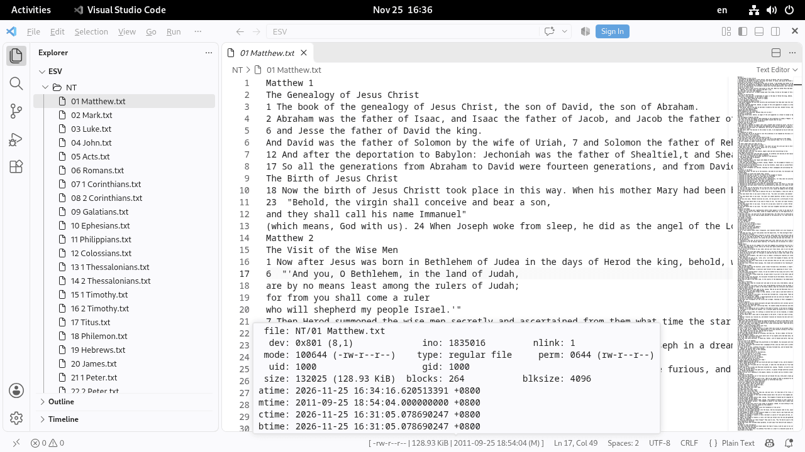

# File StatBar

A lightweight VS Code extension: File stats at a glance in your status bar.

## Features

- **Universal Support**: Works across text files, images, binary files, etc.
- **Customizable Status Bar**: Real-time display of active file metadata.
- **Hover Tooltip**: Detailed monospace tooltip showing full file metadata.

> **Note:**
>
> - On non-POSIX platforms or filesystems, `mode` is synthesized.
> - Symbolic links report link metadata (`lstat`), not target file metadata.
> - Unavailable fields fall back to `-`.
> - In the hover tooltip, compound fields are formatted as `value (human-friendly representation)`.

## Settings

| Setting                 | Type               | Default                                     | Description                                                      |
| :---------------------- | :----------------- | :------------------------------------------ | :--------------------------------------------------------------- |
| `file-statbar.template` | `string`           | `"[ {mode} \| {size:iec} \| {mtime} (M) ]"` | Status bar display template.                                     |
| `file-statbar.position` | `"left"`/`"right"` | `"right"`                                   | Position on the status bar.                                      |
| `file-statbar.priority` | `number`           | `1024`                                      | Status bar priority (higher values place item closer to center). |

### `file-statbar.template`

Placeholders use `{<field>}` or `{<field>:<modifier>}` to display file attributes and select an optional output modifier. To output literal braces, escape them as `{{` and `}}`.

#### File Mode

| Placeholder             | Description                      | Example            |
| :---------------------- | :------------------------------- | :----------------- |
| `{mode}` / `{mode:s}`   | POSIX symbolic mode              | `-rw-r--r--`       |
| `{mode:b}`              | 16-bit binary mode bitmask       | `1000000110100100` |
| `{mode:o}`              | 6-digit octal mode bitmask       | `100644`           |
| `{mode:d}`              | Raw decimal mode integer         | `33188`            |
| `{mode:x}` / `{mode:X}` | 4-digit hex mode (lower / upper) | `81a4` / `81A4`    |

#### File Size

| Placeholder               | Description                                                                              | Example    |
| :------------------------ | :--------------------------------------------------------------------------------------- | :--------- |
| `{size}` / `{size:bytes}` | Raw byte count                                                                           | `1178 B`   |
| `{size:si}`               | SI (International System of Units) metric units (1000-based: kB, MB, GB)                 | `1.18 kB`  |
| `{size:iec}`              | IEC (International Electrotechnical Commission) binary units (1024-based: KiB, MiB, GiB) | `1.15 KiB` |

#### Timestamps

| Placeholder | Description                    |
| :---------- | :----------------------------- |
| `{atime}`   | Time of last access            |
| `{mtime}`   | Time of last data modification |
| `{ctime}`   | Time of last status change     |
| `{btime}`   | Time of file birth (creation)  |

Supported modifiers via `:<modifier>` (default: `datetime`):

| Modifier   | Description                                            | Example                     |
| :--------- | :----------------------------------------------------- | :-------------------------- |
| `iso-8601` | ISO 8601 extended local date-time (`±HH:MM` offset)    | `2026-11-05T14:30:45+08:00` |
| `iso-utc`  | ISO 8601 extended UTC date-time (`Z` suffix)           | `2026-11-05T06:30:45Z`      |
| `datetime` | Local date and time (`YYYY-MM-DD HH:MM:SS`, no offset) | `2026-11-05 14:30:45`       |
| `date`     | Local calendar date (`YYYY-MM-DD`)                     | `2026-11-05`                |
| `time`     | Local 24-hour wall-clock time (`HH:MM:SS`)             | `14:30:45`                  |

## Commands

All commands can be executed via the Command Palette (`Ctrl+Shift+P` / `Cmd+Shift+P`):

- `File StatBar: Refresh` (`file-statbar.refresh`): Manually refresh file statistics for the active editor.
